# EVE Imager

A graphical tool for writing [LF Edge EVE-OS](https://github.com/lf-edge/eve) installer images to USB drives. Built on top of [Raspberry Pi Imager](https://github.com/raspberrypi/rpi-imager).

EVE Imager downloads EVE-OS releases directly from GitHub, lets you configure device settings (controller, network, WiFi, proxy and more), writes the image to a USB drive, and verifies the result — all in one guided workflow.

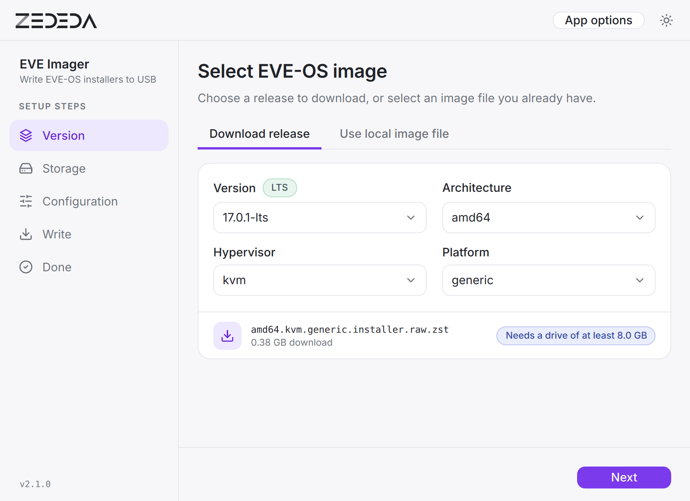

---

## Features

- **Live release browser** — paginates all EVE-OS releases from [lf-edge/eve GitHub releases](https://github.com/lf-edge/eve/releases), showing the newest patch release of each LTS line, newest line first (17.0.x, 16.0.x, 14.5.x, …)
- **LTS filter** — shows only releases tagged `X.Y.Z-lts`, and of each LTS line (`X.Y`) only the newest patch; if that newest patch was published without images for an architecture (e.g. arm64) that an older patch of the same line still has, the older patch is listed too; use the _Use local image file_ tab for non-LTS builds
- **Cascading selection** — choose Version → Architecture → Hypervisor → Platform; only combinations that actually have installer assets are shown
- **OnLogic FR201** — for arm64/kvm the Platform list also offers _OnLogic FR201_ and _OnLogic FR201 without eMMC_: the generic image with the FR201 boot configuration applied after writing
- **Multi-format support** — handles `.installer.raw`, `.installer.raw.zst` (zstd-compressed), `.installer.img` (gzip-compressed, used by older EVE ≤12.x releases), and `.installer.iso`; compressed formats are decompressed on the fly while writing; when a release offers both `.installer.raw` and `.installer.raw.zst`, the smaller `.raw.zst` download is used
- **Drive size check** — a compressed image unpacks to much more than its download size (the EVE-OS 17.0 installer images are ~400 MB to download but 8 GiB on the drive, so they need a 16 GB USB stick). The real size is read from the first bytes of the file when you pick a release; drives that are too small are marked in the storage list and cannot be selected
- **Device configuration** — optionally pre-configure the device before writing, in a **Simple** or an **Advanced** view (an installer ISO takes everything except the installation options):
  - _Simple_: controller (the ZEDEDA clusters are suggested, any host name can be typed), WiFi, _My network uses a proxy_, and _My network inspects encrypted traffic_ with the inspection CA certificate (for a proxy or a firewall that opens HTTPS traffic)
  - _Advanced_ adds: controller root certificate and onboarding certificate/key, network interfaces (DHCP or static, NTP servers, VLANs, management or not), a proxy found by automatic discovery (WPAD) or a PAC script, the do-not-proxy list, several inspection CA certificates, install / `/persist` / wipe disks, soft serial number, console, auto-reboot, an SSH key for the debug console, and a bootstrap config exported by the controller
- **Save as a file** — instead of writing to a drive, save the image with your configuration: as a raw image (`.raw`, or compressed `.raw.zst`) to write later, or as the release's installer ISO or network boot archive (`installer-net.tar`) for network (PXE) installation
- **Local image support** — bypass the GitHub release browser and write an image file you already have instead: `.raw`, `.img`, `.raw.zst` or `.iso`, including one saved earlier with this app
- **Write + verify** — streams the download directly to the USB device and verifies the written data afterwards; the Write page shows the percentage, the amount written and the current stage
- **Write again** — after a finished, cancelled or failed write you can write the same image to another drive, or go back and change the selection, without restarting the app
- **5-step wizard** — Version → Storage → Configuration → Write → Done
- **Light and dark appearance** — follows the system setting; the button at the top right switches between system, light and dark, and the choice is remembered
- **App options** — play a sound when finished, eject the drive when finished, disable the confirmation warnings

---

## Screenshots

### The five steps

| | |
|---|---|
| **1. Version** — pick a release, or a local image file | **2. Storage** — choose a drive, or save as a file |
|  | 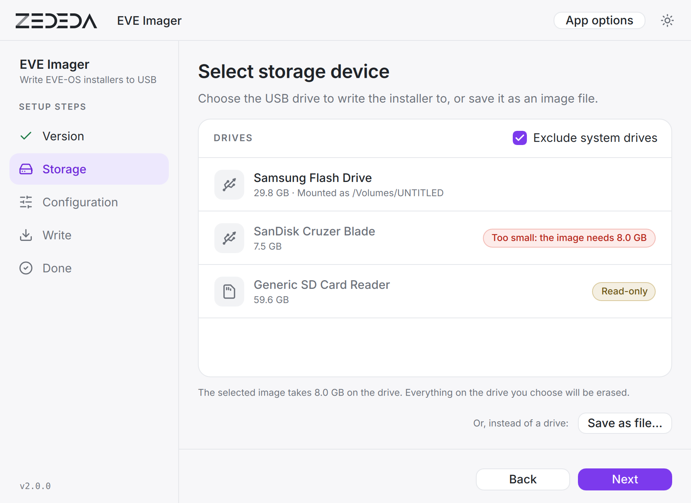 |
| **3. Configuration, Simple** — controller, WiFi, proxy and traffic inspection | **3. Configuration, Advanced** — every setting, one section each |
|  |  |
| **4. Write** — progress, amount written and stage | **5. Done** |
| 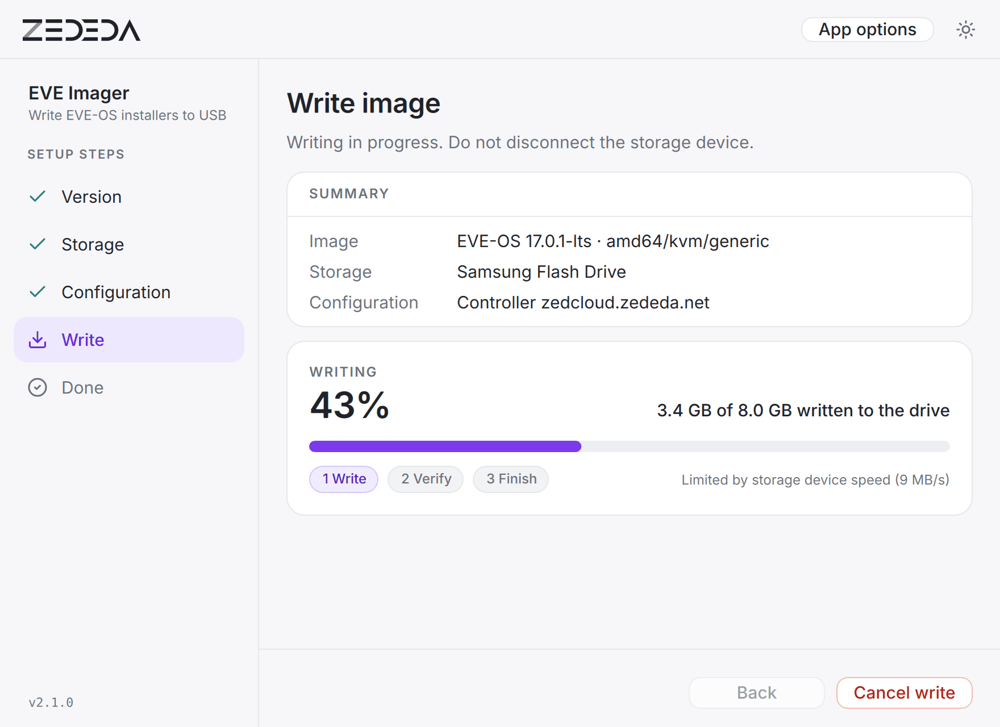 | 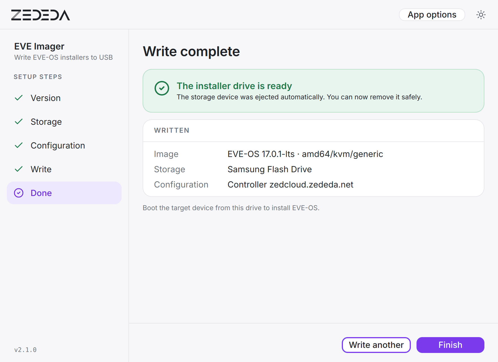 |

### Configuration in detail

| | |
|---|---|
| **Proxy and traffic inspection** (Simple) — two separate switches; here a firewall inspects the traffic and there is no proxy | **How the device finds the proxy** (Advanced) — its address, automatic discovery or a PAC script |
| 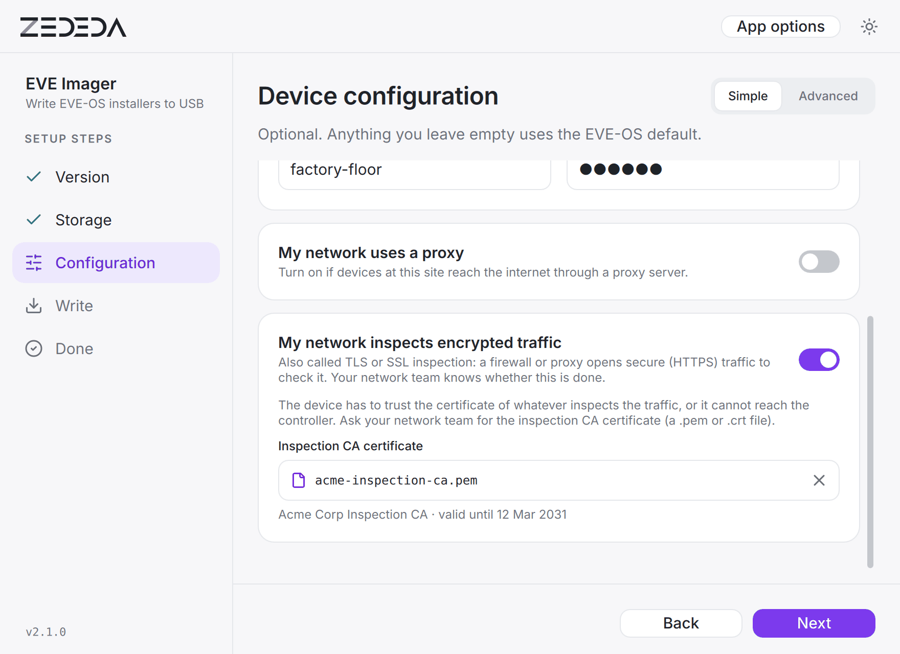 | 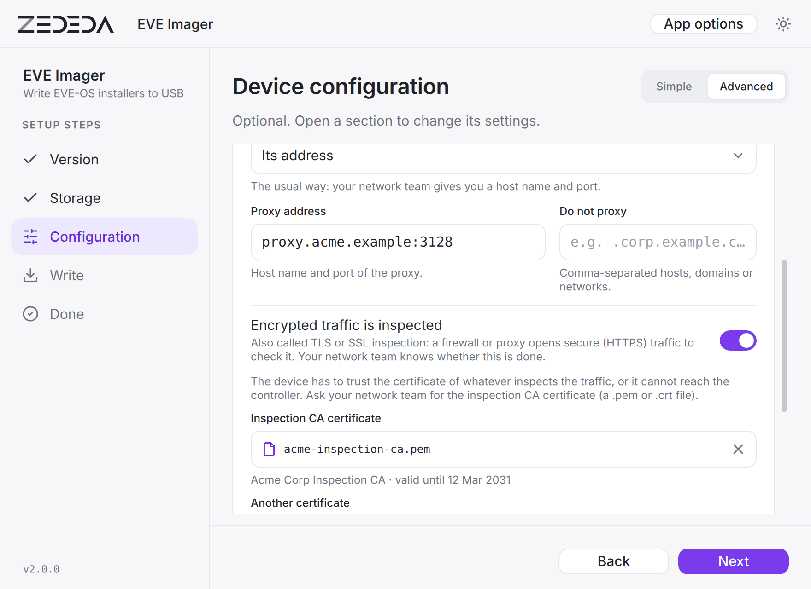 |
| **Controller** (Advanced) — the hints say when a field can stay empty | **OnLogic FR201** — in the Platform list for arm64/kvm |
| 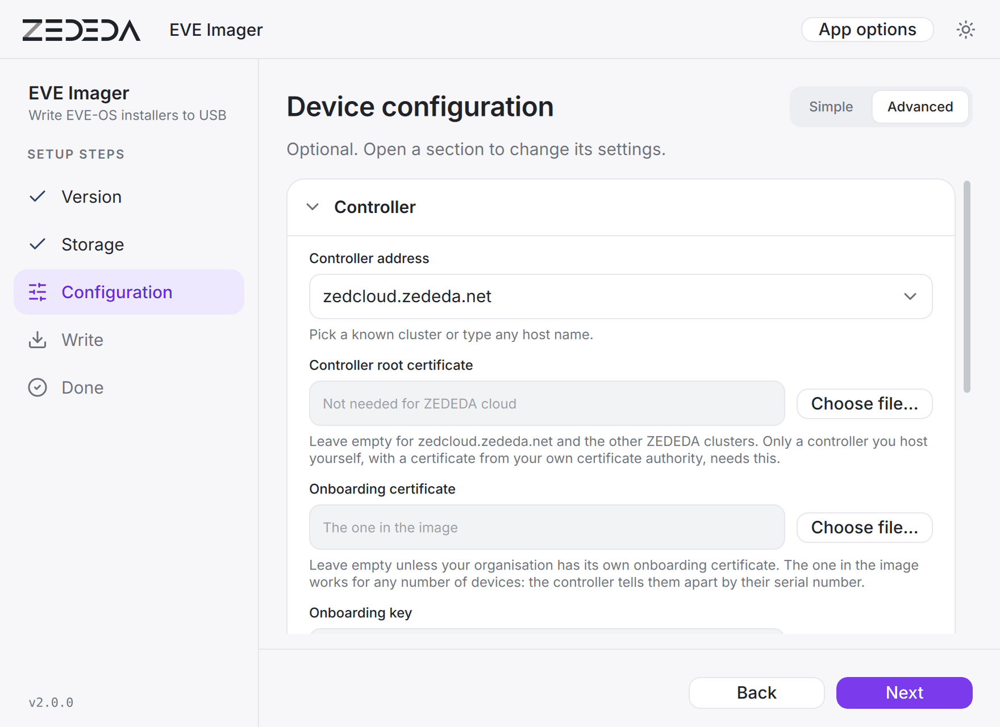 | 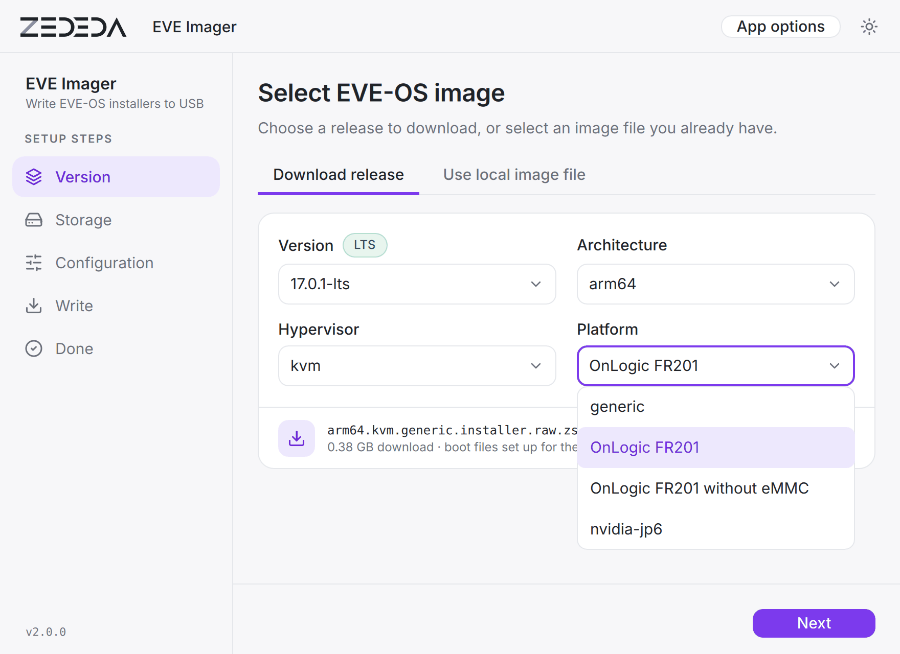 |

### Saving as a file

| | |
|---|---|
| **Save as file…** — choose what the file is for | **Summary before saving an installer ISO** |
| 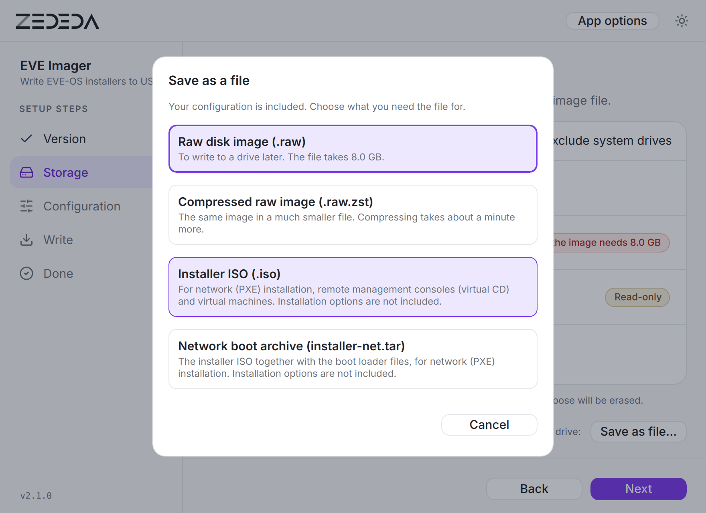 | 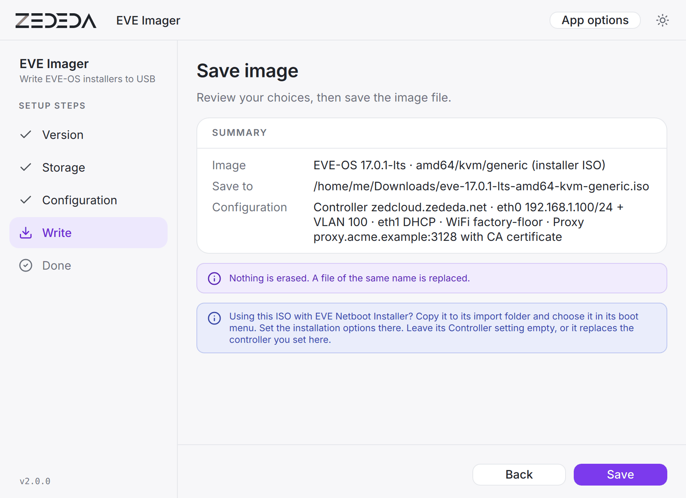 |

### Dark appearance

| | |
|---|---|
| 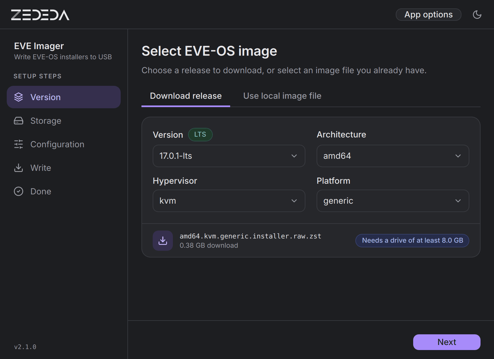 | 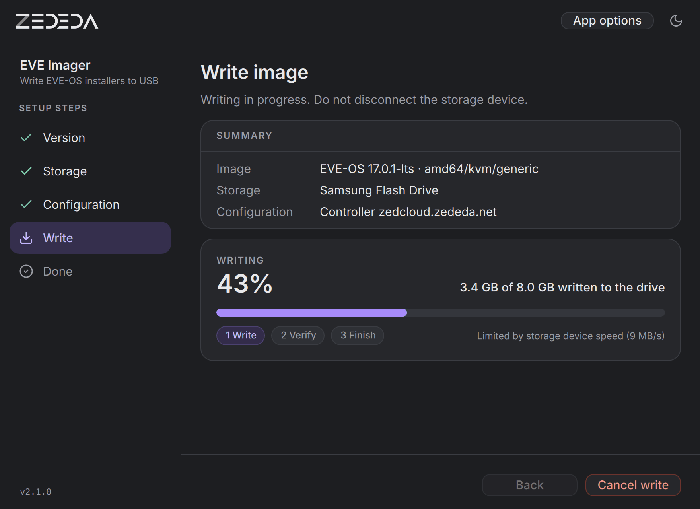 |

---

## Usage

1. **Version** — Select an EVE-OS version from the dropdown (loaded live from GitHub, newest first). Only LTS releases are shown (tags ending in `-lts`, e.g. `17.0.1-lts`), one entry per LTS line. Choose architecture, hypervisor, and platform; the page then shows the file that will be downloaded and how large a drive it needs. For arm64 with the kvm hypervisor the Platform list also has _OnLogic FR201_ and _OnLogic FR201 without eMMC_ (see [OnLogic FR201](#onlogic-fr201-platform-list-arm64kvm)). Going back to this page later keeps what you chose. Or switch to the _Use local image file_ tab to pick a `.raw`, `.img`, `.raw.zst` or `.iso` file you already have (useful for non-LTS builds, and for an image you saved earlier).

2. **Storage** — Select the target USB drive. Drives that are too small for the image, or read-only, are marked and cannot be selected. System drives are hidden unless you untick _Exclude system drives_. Double-check the device name and size before continuing: everything on the drive will be erased.

   Instead of a drive you can save a file with **Save as file…**. Your configuration is included. The formats:

   | Format | Use |
   |---|---|
   | Raw disk image (`.raw`) | To write to a drive later: choose the file under _Use local image file_. As large as the drive image (8 GB for EVE-OS 17.0). |
   | Compressed raw image (`.raw.zst`) | The same, in a much smaller file (about 0.4 GB for EVE-OS 17.0). Compressing takes about a minute more. |
   | Installer ISO (`.iso`) | For network (PXE) installation with [EVE Netboot Installer](https://github.com/michiel-zededa/eve-netboot-installer) (see [Using the ISO with EVE Netboot Installer](#using-the-iso-with-eve-netboot-installer)), for remote management consoles (virtual CD) and for virtual machines. |
   | Network boot archive (`installer-net.tar`) | The installer ISO together with the boot loader files, for network (PXE) installation. |

   The ISO and the archive are the release's own files and are offered when the release has them; they do not take the installation options or the OnLogic FR201 setup. Nothing is erased when saving, and a file that could not be completed is removed again.

3. **Configuration** _(optional)_ — The switch at the top right chooses the view; the app remembers it.
   - **Simple** asks only where the device connects: the controller (`zedcloud.zededa.net` by default), a WiFi network if there is no cable, whether the site uses a proxy, and whether the network inspects encrypted traffic. The last two are separate: a proxy is an address the device sends its traffic to; inspection can be done by that proxy or by a firewall the device is never told about, and then there is only a certificate to choose.
   - **Advanced** shows every setting in sections that open and close; a closed section says what is set in it.
   - Settings made in Advanced stay in effect when you switch back to Simple; Simple lists them so that nothing is applied unseen.
   - **Next** checks the settings (addresses, certificate files, sizes) and says what to correct. Anything left empty uses the EVE-OS default. For an installer ISO the Installation section is switched off (see [Configuration details](#configuration-details)).

4. **Write** — Review the summary (image, storage, configuration) and click **Write**, then confirm that the drive may be erased. EVE Imager downloads the image (if not using a local file), streams it to the USB drive, and verifies the result. **Cancel write** stops the write and returns to the summary. When saving to a file the button reads **Save** and there is nothing to confirm.

5. **Done** — The drive is ejected automatically (unless you turned that off under _App options_). Boot your target device from it, or choose **Write another** to write the same image to another drive. After saving a file, the page shows where it was saved.

---

## Using the ISO with EVE Netboot Installer

[EVE Netboot Installer](https://github.com/michiel-zededa/eve-netboot-installer) installs EVE-OS on machines over the network (PXE), without a USB drive. An installer ISO saved by EVE Imager is the way to give those machines a device configuration: the network, WiFi, proxy and certificate settings travel inside the ISO. Its side of this is described in [Device configuration with EVE Imager](https://github.com/michiel-zededa/eve-netboot-installer#device-configuration-with-eve-imager).

**Steps**

1. In EVE Imager, choose the release on the first page.
2. On the Storage step choose **Save as file…** → **Installer ISO (.iso)** and give the file a name that says which configuration it holds, for example `eve-17.0.1-site-amsterdam.iso`.
3. Make the settings under **Configuration**, then **Save**.
4. Copy the ISO into EVE Netboot Installer's import folder. On its VM appliance, upload it in the web management or copy it to its SMB share.
5. Within a minute the ISO is in the boot menu under _Local installers_, with its file name. Choose it on the machine to install.

**What carries over, and what does not**

Everything you set under **Configuration** is inside the ISO and reaches the device. EVE Netboot Installer does not change it, with one exception: the controller.

| | Settings | With EVE Netboot Installer |
|---|---|---|
| **Carried over** | Network interfaces (static address, DNS, NTP, VLANs), WiFi, proxy settings, inspection CA certificates, controller root certificate, onboarding certificate and key, SSH key, bootstrap config | Used as saved in the ISO. The netboot installer has no settings for these. |
| **Carried over, unless replaced** | Controller address | Used as saved in the ISO **only if the netboot installer's _Controller_ setting is empty**. If it has a value, the installer writes that value over the one in the ISO, without a message. |
| **Not in the ISO** | Install disk, `/persist` disk, wipe disks, reboot after installation, soft serial, console | Set in the netboot installer's boot menu under _Installation options..._. An ISO cannot hold them, which is why EVE Imager greys out its Installation section for an ISO. By default the netboot installer uses the machine's MAC address as the soft serial. |

Where to find the netboot installer's _Controller_ setting, to leave it empty (or set it to the same controller):

- on the VM appliance: _Installer defaults_ → _Controller_;
- with Docker Compose: `EVE_DEFAULT_INSTALL_SERVER`;
- for one machine: clear it in the boot menu under _Installation options..._; the menu then shows _Controller: from ISO_.

The proxy and inspection settings take effect when the installed device starts and contacts the controller. The installation itself does not need them: the machine loads everything from the boot server on the local network.

**Good to know**

- One ISO holds one configuration. Another site, network or proxy is another ISO and another entry in the boot menu.
- A new EVE-OS release needs a new ISO from EVE Imager.
- Everything in the ISO can be downloaded by anyone on the boot network, including the WiFi password and the onboarding key. Put it only on a boot network you trust with those.
- Not yet confirmed on a real device: a network boot of an ISO whose configuration EVE Imager changed. It is expected to work, because nothing else in the ISO changes. Check the first machine before installing a batch.

---

## Supported EVE-OS images

EVE-OS publishes installer images for:

| Architecture | Hypervisor | Platform examples |
|---|---|---|
| amd64 | kvm | generic, evaluation |
| amd64 | k | generic |
| arm64 | kvm | generic, nvidia-jp5, nvidia-jp6, nvidia-jp7 (plus OnLogic FR201, which uses the generic image) |
| arm64 | k | generic, nvidia-jp5, nvidia-jp6, nvidia-jp7 |

> **Note:** The raw image is what gets written to a drive; the release's installer ISO and network boot archive are offered on the Storage step for saving. An ISO has no CONFIG partition: it carries the same file system as a file, `config.img`, and EVE Imager writes the configuration there. The network boot archive holds that same ISO, and its `config.img` is reached the same way. The installation options (disks, soft serial, console, reboot) and the OnLogic FR201 setup need the raw image.

> **Note:** If a release is missing from the version list, it may be incorrectly marked as `prerelease=true` on GitHub. Ask the EVE team to correct the release — no code change is needed in EVE Imager.

---

## Configuration details

After writing the image, EVE Imager puts these files on the `CONFIG` FAT partition of the drive — or, for an installer ISO, into the `config.img` file inside the ISO, which the installer uses in the same way. Only files for settings you made are written.

### Controller and onboarding

| File | Setting |
|---|---|
| `server` | Controller host name. Suggested: `zedcloud.zededa.net` (default), `zedcloud.gmwtus.zededa.net`, `zedcloud.pacteu.zededa.net`; any host name can be typed. |
| `root-certificate.pem` | _Controller root certificate_ — leave empty for the ZEDEDA clusters. Only a controller you host yourself, whose certificate is signed by your own certificate authority, needs it. |
| `onboard.cert.pem`, `onboard.key.pem` | _Onboarding certificate_ and _key_, in place of the ones in the image. Leave empty unless your organisation has its own. The one in the image works for any number of devices: the device registers with it and sends its serial number, and the controller matches that to the node you created. |
| `authorized_keys` | _SSH public key_ for the debug console. |

### Network, WiFi and proxy

| File | Setting |
|---|---|
| `DevicePortConfig/override.json` | Network interfaces (DHCP or static address, gateway, DNS, NTP, VLANs, management or not), WiFi (SSID and WPA2 password), proxy (address, _do not proxy_ list, PAC URL or PAC file, or automatic discovery) and the inspection CA certificates. Not written when none of these is set: EVE-OS then uses DHCP on its wired ports. |
| `bootstrap-config.pb` | A _bootstrap config_ exported by the controller. EVE-OS then ignores `override.json`, so the Network interfaces, WiFi and Proxy sections are switched off while one is chosen. |

Notes:

- **How the device finds the proxy.** One way is written, because EVE-OS uses a PAC script whenever it has one: the proxy's address (with an optional _do not proxy_ list), automatic discovery (WPAD: the device asks the network through DHCP and DNS), a PAC script at a URL, or a PAC file that is put on the device.
- **Traffic inspection (TLS or SSL inspection).** A proxy or firewall that opens HTTPS traffic to check it presents its own certificates, so the device must trust its CA before it can reach the controller. This is independent of the proxy setting: a firewall or transparent proxy inspects without the device being given any address, and then the certificate is all there is to configure. The CA certificate (PEM or DER; several are possible in Advanced) goes into the network configuration, the same place the controller would put it. The app shows the certificate's subject and expiry date when you choose the file, and refuses a file that is not a certificate.
- **Simple view and ports.** WiFi, proxy and inspection settings made in the Simple view apply to `eth0` (and `wlan0` for WiFi). If the device's uplink is another port, list it under _Network interfaces_ in Advanced.
- The network configuration only gets the device online for onboarding; once the device is onboarded, the controller's network configuration takes over.
- EVE-OS limits `override.json` to 16 KB. The app tells you when certificates make it larger.

### Installation (written to `grub.cfg`)

| Kernel parameter | Setting |
|---|---|
| `eve_install_disk=<disk>` | _Install EVE-OS on_ — a specific disk, e.g. `nvme0n1`. |
| `eve_persist_disk=<disk>` | _Store data (/persist) on_ — a separate disk, or several separated by commas. |
| `eve_nuke_disks=<disks>` | _Wipe these disks first_ — clears their partition tables before installing. |
| `eve_soft_serial=<serial>` | _Soft serial number_ — identifies the device at onboarding in place of the hardware serial. |
| `eve_reboot_after_install` | _Reboot automatically after installation_. |
| `console=…` | _Console_ — screen or serial port as the main console. The serial port is `ttyS0` at 115200 baud, which is right for PCs (amd64) and for the OnLogic FR201. Other ARM boards have other serial ports (`ttyAMA0`, `ttyTCU0`, `ttymxc0`, …) that EVE-OS selects itself, so the choice is switched off for them. |

Not for an installer ISO: the boot loader reads `grub.cfg` only from a CONFIG partition, so these options are left out there (with network installation, kernel parameters are set on the boot server).

An existing `grub.cfg` on the partition is kept; the app's lines sit between `# >>> EVE Imager >>>` and `# <<< EVE Imager <<<` markers and are replaced on the next write.

### OnLogic FR201 (Platform list, arm64/kvm)

Choosing _OnLogic FR201_ as the platform downloads the generic arm64 image and, after writing, applies the [FR201 boot configuration](https://github.com/lf-edge/eve#fr201-boot-configuration) to `config.txt` on the EFI system partition: it disables the TPM overlay line and enables `include fr201.txt`. _OnLogic FR201 without eMMC_ also installs onto `sdb` (unless another install disk is set under Configuration → Advanced → Installation) and adds `rootdelay=10`. The two entries are offered for EVE-OS 14.5 and later with the kvm hypervisor, which is what EVE-OS supports on the FR201; they are not available for a local image file.

---

## Development

### Project structure

```
src/
├── evereleasefetcher.{h,cpp}     # GitHub Releases API client
├── eveconfigurator.{h,cpp}       # Writes the configuration: CONFIG partition, or config.img in an ISO / net tar
├── devicewrapperfatpartition.*   # FAT12/16/32 partition read/write
├── imagewriter.{h,cpp}           # Core download + write engine
├── wizard/
│   ├── WizardContainer.qml       # 5-step wizard shell: top bar + sidebar
│   ├── EveVersionStep.qml        # Step 0: version / image selection
│   ├── StorageSelectionStep.qml  # Step 1: USB drive picker, or save as a file
│   ├── EveCustomizationStep.qml  # Step 2: configuration, Simple and Advanced views
│   ├── WritingStep.qml           # Step 3: progress + write
│   └── DoneStep.qml              # Step 4: completion
├── qmlcomponents/                # Shared controls: buttons, cards, pills, banners, icons, fields
├── icons/
│   ├── app-icon.svg              # App icon artwork
│   └── generate-app-icons.py     # Regenerates the .icns / .ico / .png files from it
└── Style.qml                     # Colour tokens (light + dark), fonts, layout constants
```

### Look and feel

The UI follows the ZEDEDA product style: a light grey page, white cards with thin borders, one purple accent, status pills, the Inter typeface. All colours are tokens in `src/Style.qml`, each with a light and a dark value; the QML does not hard-code colours. Icons in the UI are vector paths in `src/qmlcomponents/ImIcon.qml` so that they take the theme colour.

### Building for development

```bash
# First time on a new machine:
./setup-codesign.sh          # creates a local code-signing certificate

./run-dev.sh --rebuild       # configure + build + sign + launch
./run-dev.sh                 # sign + launch (no rebuild)
```

`run-dev.sh` auto-detects your Qt installation (`brew --prefix qt`) and CPU architecture.

### Running with debug logging

```bash
./build/eve-imager.app/Contents/MacOS/eve-imager --log-file /tmp/eve-imager.log
```

---

## Based on

EVE Imager is a fork of [Raspberry Pi Imager](https://github.com/raspberrypi/rpi-imager) (Apache 2.0).  
The core write engine, FAT partition handling, and cross-platform build system are inherited from that project.

---

## License

Apache License 2.0 — see [license.txt](./license.txt) for details.

The bundled Inter typeface is licensed under the SIL Open Font License 1.1 (`src/fonts/Inter-LICENSE.txt`); the UI icons are derived from [Lucide](https://lucide.dev) (ISC License).

Copyright (C) 2020 Raspberry Pi Ltd (original)  
Copyright (C) 2025-2026 ZEDEDA, Inc. (EVE Imager additions)
