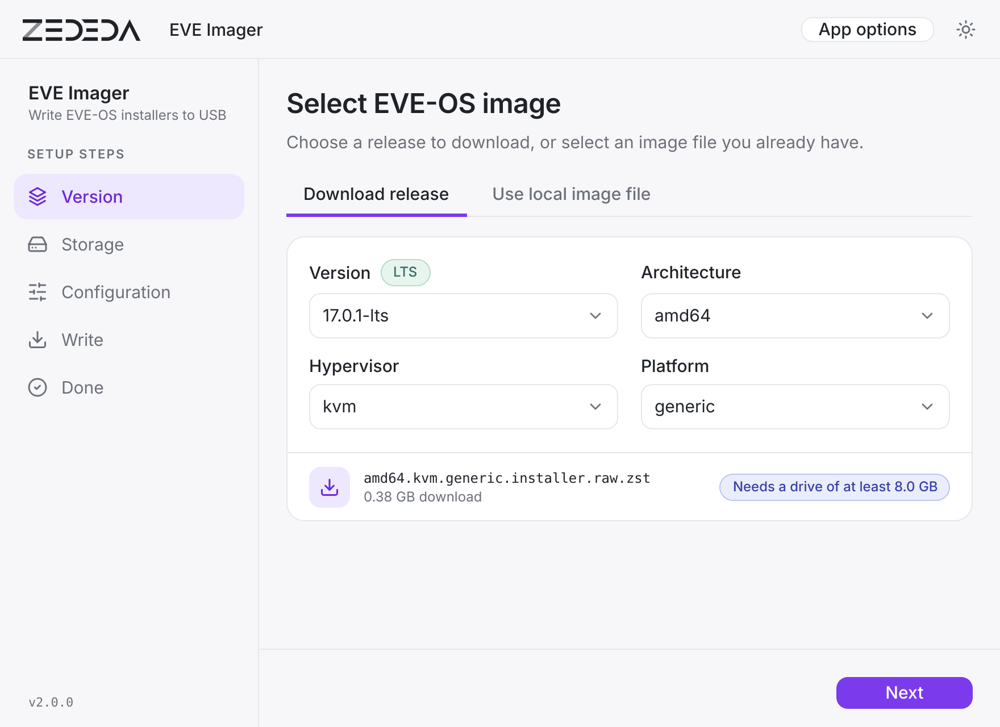
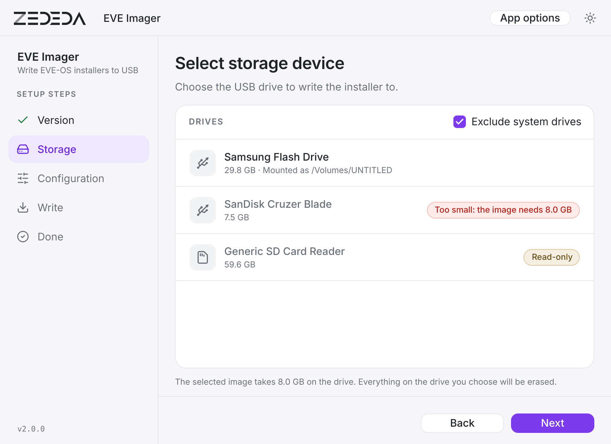
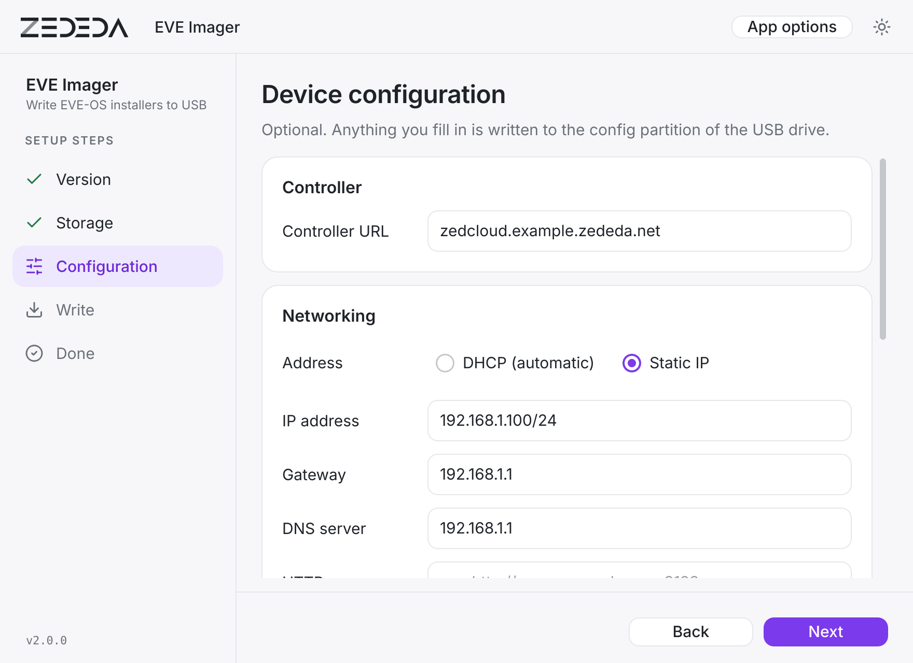
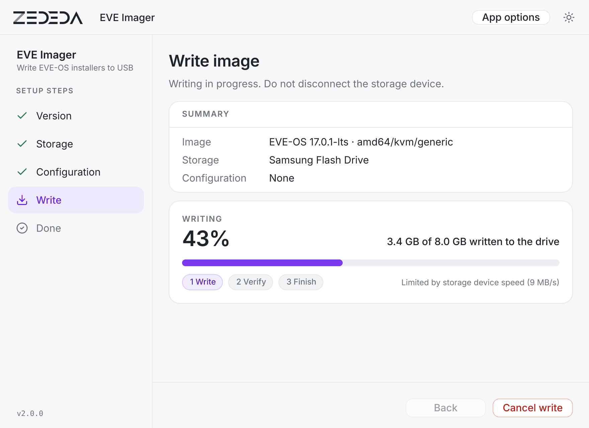
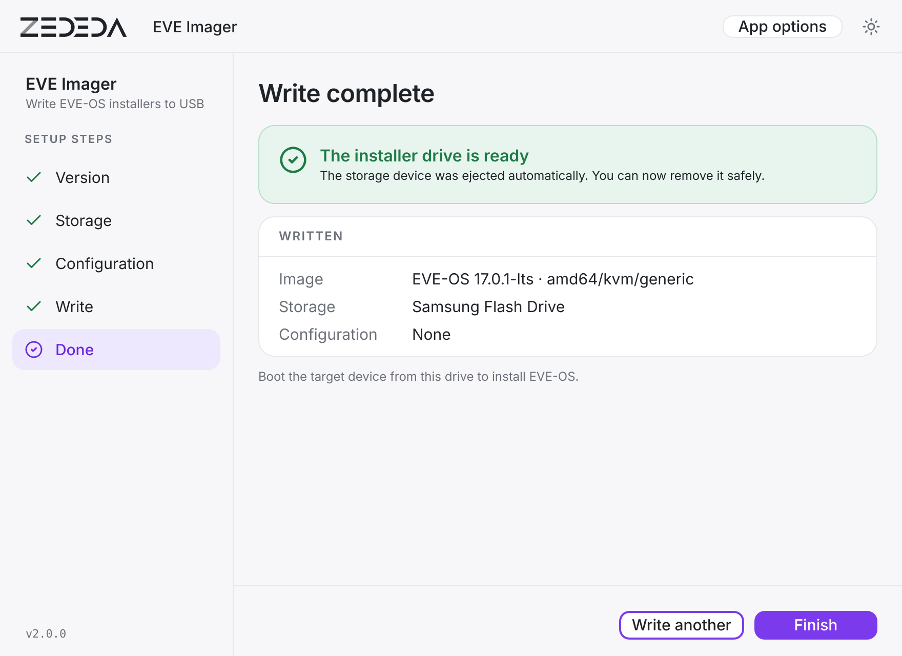
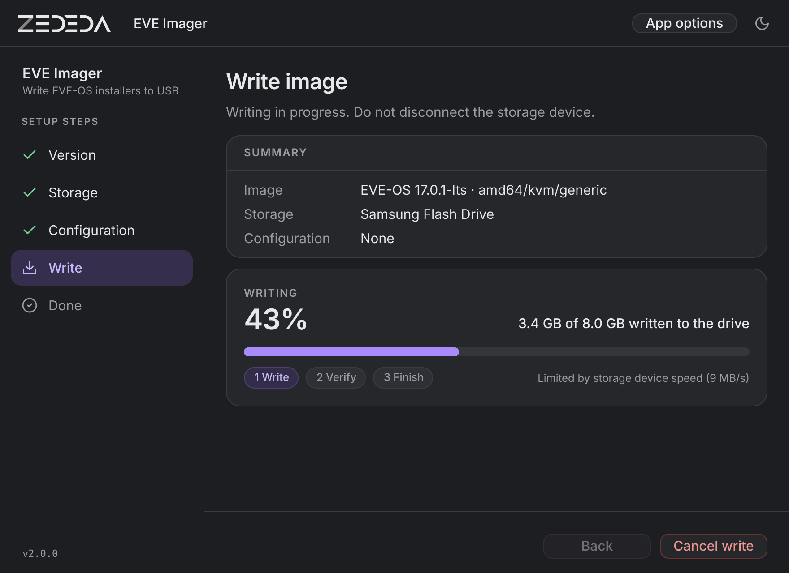

# EVE Imager

A graphical tool for writing [LF Edge EVE-OS](https://github.com/lf-edge/eve) installer images to USB drives. Built on top of [Raspberry Pi Imager](https://github.com/raspberrypi/rpi-imager).

EVE Imager downloads EVE-OS releases directly from GitHub, lets you configure device settings (controller URL, network, WiFi), writes the image to a USB drive, and verifies the result — all in one guided workflow.



---

## Features

- **Live release browser** — paginates all EVE-OS releases from [lf-edge/eve GitHub releases](https://github.com/lf-edge/eve/releases), showing the newest patch release of each LTS line, newest line first (17.0.x, 16.0.x, 14.5.x, …)
- **LTS filter** — shows only releases tagged `X.Y.Z-lts`, and of each LTS line (`X.Y`) only the newest patch; if that newest patch was published without images for an architecture (e.g. arm64) that an older patch of the same line still has, the older patch is listed too; use the _Use local image file_ tab for non-LTS builds
- **Cascading selection** — choose Version → Architecture → Hypervisor → Platform; only combinations that actually have installer assets are shown
- **Multi-format support** — handles `.installer.raw`, `.installer.raw.zst` (zstd-compressed), `.installer.img` (gzip-compressed, used by older EVE ≤12.x releases), and `.installer.iso`; compressed formats are decompressed on the fly while writing; when a release offers both `.installer.raw` and `.installer.raw.zst`, the smaller `.raw.zst` download is used; ISO images skip the config customization step
- **Drive size check** — a compressed image unpacks to much more than its download size (the EVE-OS 17.0 installer images are ~400 MB to download but 8 GiB on the drive, so they need a 16 GB USB stick). The real size is read from the first bytes of the file when you pick a release; drives that are too small are marked in the storage list and cannot be selected
- **Device configuration** — optionally pre-configure the device before writing (RAW images only):
  - Controller URL
  - Network mode: DHCP or static IP (address, gateway, DNS)
  - HTTP/HTTPS proxy
  - WiFi (SSID and WPA2 password)
  - Target install disk and separate `/persist` disk
  - Auto-reboot after installation
- **Local image support** — bypass the GitHub release browser and write a locally downloaded `.raw` or `.iso` file instead
- **Write + verify** — streams the download directly to the USB device and verifies the written data afterwards; the Write page shows the percentage, the amount written and the current stage
- **Write again** — after a finished, cancelled or failed write you can write the same image to another drive, or go back and change the selection, without restarting the app
- **5-step wizard** — Version → Storage → Configuration → Write → Done
- **Light and dark appearance** — follows the system setting; the button at the top right switches between system, light and dark, and the choice is remembered
- **App options** — play a sound when finished, eject the drive when finished, disable the confirmation warnings

---

## Screenshots

| | |
|---|---|
| **1. Version** — pick a release, or a local image file | **2. Storage** — drives that are too small or read-only cannot be selected |
|  |  |
| **3. Configuration** — optional controller, network, WiFi and install settings | **4. Write** — progress, amount written and stage |
|  |  |
| **5. Done** | **Dark appearance** |
|  |  |

---

## Installation

### Download prebuilt binaries (recommended)

Every [GitHub release](https://github.com/michiel-zededa/eve-imager/releases) ships ready-to-run binaries, built automatically by GitHub Actions:

| Platform | Asset | Notes |
|---|---|---|
| Linux x86_64 | `EVE-Imager-<version>-linux-x86_64.AppImage` | `chmod +x` then run — see the Linux note below |
| Linux arm64 | `EVE-Imager-<version>-linux-aarch64.AppImage` | as above |
| macOS (universal) | `EVE-Imager-<version>-macOS-universal.dmg` | Apple Silicon + Intel; see the note below |
| Windows x64 | `EVE-Imager-<version>-windows-x64-setup.exe` | run the installer as Administrator |

> **macOS — the app is not signed with an Apple Developer ID.** The first time you open it, macOS Gatekeeper will refuse to launch it. Either **right-click (or Control-click) the app → Open → Open**, or go to **System Settings → Privacy & Security** and click **Open Anyway**. macOS remembers the exception after that. (Signing/notarization would remove this step but requires a paid Apple Developer account.)

> **Windows** is not signed either, so SmartScreen may warn on first run — choose **More info → Run anyway**.

> **Linux — running the AppImage.** Make it executable and run it as your normal user (it elevates itself via `pkexec` only when it needs to write a device — no need to launch it with `sudo`):
> ```bash
> chmod +x EVE-Imager-*-linux-*.AppImage
> ./EVE-Imager-*-linux-*.AppImage
> ```
> On a full desktop this just works. On a **minimal or VM install** you may hit `libOpenGL.so.0: cannot open shared object file` (or a similar `libEGL`/`libGL` error) — the OpenGL libraries are GPU-driver-coupled (part of [libglvnd](https://gitlab.freedesktop.org/glvnd/libglvnd)), so the AppImage relies on the host providing them. Install them once, per distro:
> ```bash
> # Debian / Ubuntu
> sudo apt install -y libopengl0 libegl1 libglx0
>
> # Fedora / RHEL / CentOS / Rocky / Alma
> sudo dnf install -y libglvnd-opengl libglvnd-egl libglvnd-glx
>
> # openSUSE / SLE
> sudo zypper install -y libglvnd Mesa-libEGL1 Mesa-libGL1
> ```
> If instead you get a FUSE error (`libfuse.so.2` / `fusermount`), install FUSE 2 (`libfuse2` on Debian/Ubuntu, `fuse-libs` on Fedora/RHEL, `libfuse2` on openSUSE) or run the AppImage with `--appimage-extract-and-run`.

To build from source instead, follow the platform sections below.

### macOS (build from source)

Requirements: Xcode command-line tools, CMake ≥ 3.22, Qt 6.9 or newer (via Homebrew: `brew install qt`)

```bash
git clone https://github.com/michiel-zededa/eve-imager.git
cd eve-imager

# One-time: create a local code-signing certificate so the app runs permanently
./setup-codesign.sh

# Build and launch
./run-dev.sh --rebuild
```

`run-dev.sh` auto-detects your Qt installation and architecture, builds the app, signs it with the local certificate, and opens it. On subsequent runs you only need `./run-dev.sh` (no rebuild needed unless sources changed).

> **Note:** The build system (`cmake`) auto-signs the app after every rebuild. The `setup-codesign.sh` step only needs to be run once per machine.

#### Distributing to others

The local self-signed certificate is machine-specific and cannot be bundled with the app. For sharing with colleagues:

- **Quick option:** Recipients right-click the `.app` → **Open** the first time to bypass Gatekeeper. macOS remembers the exception.
- **Proper distribution:** Sign with an [Apple Developer ID](https://developer.apple.com/programs/) certificate and notarize — the app will then run on any Mac without any extra steps.

### Linux (build from source)

Requirements: CMake ≥ 3.22 and **Qt 6.9 or newer**. The Qt packages of most distributions are older than that, so install Qt with the [Qt Online Installer](https://www.qt.io/download-qt-installer) or [aqtinstall](https://github.com/miurahr/aqtinstall) and point CMake at it. The other libraries (curl, libarchive, zstd, xz, zlib) are downloaded and built as part of the build.

```bash
sudo apt install build-essential cmake ninja-build git pkg-config \
    libgnutls28-dev libudev-dev libdbus-1-dev \
    libgl1-mesa-dev libxkbcommon-dev libvulkan-dev
git clone https://github.com/michiel-zededa/eve-imager.git
cd eve-imager
cmake -S src -B build -DCMAKE_BUILD_TYPE=Release \
    -DCMAKE_PREFIX_PATH=/path/to/Qt/6.9.1/gcc_64
cmake --build build
./build/eve-imager   # asks for elevated rights (pkexec) when it writes to a device
```

The release AppImages are built with `./create-appimage.sh --qt-root=/path/to/Qt/6.9.1/gcc_64`.

### Windows

Build with CMake + Qt 6.9 or newer (MinGW kit) via the Qt Online Installer: `cmake -S src -B build`, then `cmake --build build`. Run as Administrator (raw device write access requires elevation).

---

## Usage

1. **Version** — Select an EVE-OS version from the dropdown (loaded live from GitHub, newest first). Only LTS releases are shown (tags ending in `-lts`, e.g. `17.0.1-lts`), one entry per LTS line. Choose architecture, hypervisor, and platform; the page then shows the file that will be downloaded and how large a drive it needs. Or switch to the _Use local image file_ tab to pick a `.raw` or `.iso` file you already have (useful for non-LTS builds).

2. **Storage** — Select the target USB drive. Drives that are too small for the image, or read-only, are marked and cannot be selected. System drives are hidden unless you untick _Exclude system drives_. Double-check the device name and size before continuing: everything on the drive will be erased.

3. **Configuration** _(optional, RAW images only)_ — Configure any combination of the settings below. Leave everything blank to write a plain image and configure the device through the controller later. This step is skipped automatically for ISO images.

4. **Write** — Review the summary (image, storage, configuration) and click **Write**, then confirm that the drive may be erased. EVE Imager downloads the image (if not using a local file), streams it to the USB drive, and verifies the result. **Cancel write** stops the write and returns to the summary. A notice is shown when writing an ISO to remind you that pre-configuration is not available.

5. **Done** — The drive is ejected automatically (unless you turned that off under _App options_). Boot your target device from it, or choose **Write another** to write the same image to another drive.

---

## Supported EVE-OS images

EVE-OS publishes installer images for:

| Architecture | Hypervisor | Platform examples |
|---|---|---|
| amd64 | kvm | generic, evaluation |
| amd64 | k | generic |
| arm64 | kvm | generic, nvidia-jp5, nvidia-jp6, nvidia-jp7 |
| arm64 | k | generic, nvidia-jp5, nvidia-jp6, nvidia-jp7 |

> **Note:** ISO images can be written to USB as bootable installers, but device configuration (controller URL, network settings) cannot be applied — only `.raw` and `.raw.zst` images have a CONFIG partition.

> **Note:** If a release is missing from the version list, it may be incorrectly marked as `prerelease=true` on GitHub. Ask the EVE team to correct the release — no code change is needed in EVE Imager.

---

## Configuration details

When you fill in the Configuration step, EVE Imager writes the following files to the `CONFIG` FAT partition on the USB drive before ejecting:

### Controller

| File | Description |
|---|---|
| `server` | Controller hostname, e.g. `zedcloud.example.zededa.net` |

### Networking / WiFi

| File | Description |
|---|---|
| `DevicePortConfig/override.json` | Network port configuration. Written when static IP, a proxy, or a WiFi network is configured; omitted for plain wired DHCP. Includes a `wlan0` port with WPA2 credentials when an SSID is provided. |

The WiFi configuration uses EVE-OS's native format: `WirelessTypeWifi = 2`, `WifiKeySchemeWpaPsk = 1`, `DhcpTypeClient = 4`, as defined in EVE's device model.

### Installation (written to `grub.cfg`)

| Kernel parameter | Description |
|---|---|
| `eve_install_disk=<disk>` | Force EVE to install onto a specific disk, e.g. `nvme0n1`. Useful on servers with multiple drives. |
| `eve_persist_disk=<disk>` | Put the `/persist` partition on a separate disk, e.g. `sda`. |
| `eve_reboot_after_install` | Automatically reboot when installation completes. |

---

## Development

### Project structure

```
src/
├── evereleasefetcher.{h,cpp}     # GitHub Releases API client
├── eveconfigurator.{h,cpp}       # Writes EVE config to CONFIG partition
├── devicewrapperfatpartition.*   # FAT12/16/32 partition read/write
├── imagewriter.{h,cpp}           # Core download + write engine
├── wizard/
│   ├── WizardContainer.qml       # 5-step wizard shell: top bar + sidebar
│   ├── EveVersionStep.qml        # Step 0: version / image selection
│   ├── StorageSelectionStep.qml  # Step 1: USB drive picker
│   ├── EveCustomizationStep.qml  # Step 2: controller + network config
│   ├── WritingStep.qml           # Step 3: progress + write
│   └── DoneStep.qml              # Step 4: completion
├── qmlcomponents/                # Shared controls: buttons, cards, pills, banners, icons, fields
├── icons/
│   ├── app-icon.svg              # App icon artwork
│   └── generate-app-icons.py     # Regenerates the .icns / .ico / .png files from it
└── Style.qml                     # Colour tokens (light + dark), fonts, layout constants
```

### Look and feel

The UI follows the ZEDEDA product style: a light grey page, white cards with thin borders, one purple accent, status pills, the Inter typeface. All colours are tokens in `src/Style.qml`, each with a light and a dark value; the QML does not hard-code colours. Icons in the UI are vector paths in `src/qmlcomponents/ImIcon.qml` so that they take the theme colour.

### Building for development

```bash
# First time on a new machine:
./setup-codesign.sh          # creates a local code-signing certificate

./run-dev.sh --rebuild       # configure + build + sign + launch
./run-dev.sh                 # sign + launch (no rebuild)
```

`run-dev.sh` auto-detects your Qt installation (`brew --prefix qt`) and CPU architecture.

### Running with debug logging

```bash
./build/eve-imager.app/Contents/MacOS/eve-imager --log-file /tmp/eve-imager.log
```

---

## Based on

EVE Imager is a fork of [Raspberry Pi Imager](https://github.com/raspberrypi/rpi-imager) (Apache 2.0).  
The core write engine, FAT partition handling, and cross-platform build system are inherited from that project.

---

## License

Apache License 2.0 — see [license.txt](./license.txt) for details.

The bundled Inter typeface is licensed under the SIL Open Font License 1.1 (`src/fonts/Inter-LICENSE.txt`); the UI icons are derived from [Lucide](https://lucide.dev) (ISC License).

Copyright (C) 2020 Raspberry Pi Ltd (original)  
Copyright (C) 2025-2026 ZEDEDA, Inc. (EVE Imager additions)
